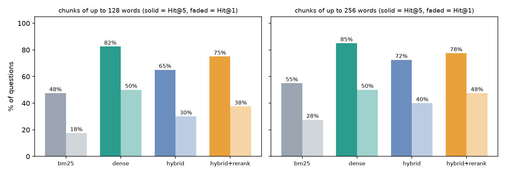
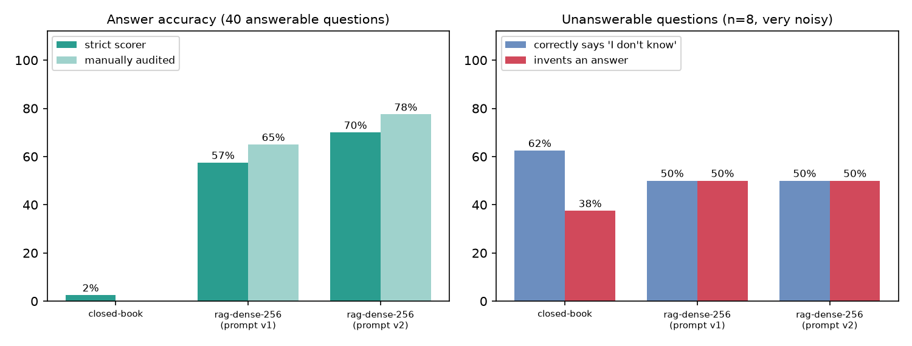

# Ask the Docs: RAG with an Honest Evaluation

A retrieval-augmented question-answering system over the real **Azure Container Apps documentation** (235 pages), built to answer one question properly: *which retrieval design actually works, and how much does retrieval help a small open model?*

Everything runs locally on a laptop CPU with open models, with no API keys. The emphasis is on **measurement**: a validated question set, four retrieval methods compared across two chunk sizes, a closed-book baseline, and an answer-by-answer failure analysis.

```mermaid
flowchart LR
  Q[question] --> R{retriever}
  D[(235 docs<br/>pinned commit)] --> C[structure-aware chunking<br/>heading path + 128/256-word chunks] --> R
  R -->|top-k passages| P[grounded prompt<br/>numbered passages, cite, or say "I don't know"]
  P --> G[Qwen2.5-1.5B-Instruct<br/>local, greedy]
  G --> A[answer + sources]
```

## Headline results

**Retrieval:** is the passage containing the answer in the top 5? (40 answerable questions, 256-word chunks)

| Method | Hit@1 | Hit@5 | MRR@10 |
|---|---|---|---|
| BM25 (keyword) | 28% | 55% | 0.40 |
| **Dense embeddings (bge-small)** | **50%** | **85%** | **0.65** |
| Hybrid (BM25 + dense, RRF) | 40% | 72% | 0.53 |
| Hybrid + cross-encoder rerank | 48% | 78% | 0.61 |



**Answers:** a 1.5B model with and without retrieval (dense retrieval, 256-word chunks, 4 passages)

| | Answer accuracy (strict scorer) | Answer accuracy (manually audited) | Invents an answer to unanswerable questions |
|---|---|---|---|
| No retrieval (closed-book) | 2% | n/a | 38% |
| RAG, first prompt (v1) | 57% | 65% | 50% |
| RAG, improved prompt (v2) | **70%** | **78%** | 50% |



Full tables (per-difficulty retrieval, failure decomposition) are in [`results/RESULTS.md`](results/RESULTS.md). Every per-question result is in `results/*.json`.

## What I found

1. **Dense retrieval beat everything else here, and hybrid was not a free upgrade.** On these paraphrased questions BM25 found the evidence for only 55% of questions. Naively fusing it with dense retrieval (equal-weight reciprocal rank fusion) *lost* 7 questions that dense alone got right, while BM25 rescued just 1 that dense missed. The reranker also scored below dense alone. I did not tune the fusion weights or try reranking the dense results, because tuning on 40 questions would just overfit them.
2. **Bigger chunks helped at k=5 across all methods** (e.g. dense 82% to 85%), but they carry about 40% more text into the prompt (about 640 vs 460 words), so it is not free.
3. **Retrieval takes a 1.5B model from 2% to 70% accuracy.** Closed-book, the model confidently invented plausible-sounding facts (a made-up probe timeout, invented CAA record syntax).
4. **Both retrieval and generation lose answers.** When the right passage was in the prompt the model was correct 79% of the time (n=34); when retrieval missed it, 17% (n=6).
5. **A prompt problem hid behind "wrong answers."** In the first run, 9 replies were bare citations like `[2]` with no answer text, including 7 of the 17 wrong answers to answerable questions. A prompt that forbids citation-only replies raised accuracy from 57% to 70% and left 1 bare reply in the whole run. (Caveat below: I iterated on the same questions.)
6. **The strict scorer undercounts.** Reading every answer showed 3 correct answers marked wrong (for example "4 minutes" against a key of "240"). Both numbers are reported; the overrides and their reasons are in [`data/manual_audit.json`](data/manual_audit.json).

**Where it still fails:** (a) it invents answers to half of the unanswerable questions (for example "about 5 to 10 minutes" to create an environment, which no document states); (b) it swaps similar-sounding numbers (answering ports 80/443 when the docs say 31080/31443, or "8 GB" for a GPU's video memory); (c) its citations are unreliable (only 8% of answers cite a passage that actually contains the evidence), so they should not be treated as verification.

## Design choices

- **Structure-aware chunking.** Split on headings, pack whole paragraphs to a word budget, merge tiny sections, and keep the heading path for citations. The title and heading are prepended to the indexed text. Fixed-size character windows would cut tables and lists mid-row.
- **Evaluation does not depend on chunking.** A retrieved chunk counts as a hit if it contains a verbatim evidence sentence from the question's record, so the comparison stays fair across chunk sizes and when the same fact appears in several pages. A validator checks that every evidence string exists in the corpus, and that every answer key appears in its evidence.
- **Deterministic scoring, no LLM judge.** Answers are checked by substring against answer keys, so results are reproducible and auditable. The cost, stated above, is wording strictness.
- **Unanswerable questions are included on purpose.** A RAG system that always answers is dangerous; 8 of the 48 questions have no answer in the docs.
- **NumPy for vector search.** At about 2,800 chunks an exact dot product takes milliseconds. FAISS or a vector database would add operations work and no accuracy.
- **Decomposed failure analysis.** Splitting accuracy by "was the evidence in the prompt?" separates retrieval failures from generation failures, which need different fixes.

## Run it

```bash
python -m venv .venv && source .venv/bin/activate         # Windows: .venv\Scripts\activate
pip install -r requirements.txt -r requirements-ci.txt
python scripts/fetch_corpus.py --commit "$(sed -n 's/^commit: //p' data/corpus_commit.txt)"   # docs at the pinned commit
pytest -q                                                  # 15 fast tests, no model downloads
python -m src.evalset                                      # validate the 48 questions against the corpus
python -m src.evaluate_retrieval                           # retrieval comparison (about 30 min on CPU, mostly embedding)
bash scripts/run_generation.sh                             # closed-book vs RAG (about 45 min on CPU)
python -m src.report                                       # tables and charts
```

Serve it (the defaults are the best measured configuration):

```bash
uvicorn src.api:app --port 8099
curl -X POST localhost:8099/ask -H "Content-Type: application/json" \
     -d '{"question": "How long does a scheduled job keep execution history?", "k": 3}'
# -> {"answer": "... the most recent 100 successful and failed job executions. [1]",
#     "sources": [{"n": 1, "doc": "jobs.md", "heading": "...", "score": 0.69, "snippet": "..."}]}
```

Answering takes about 30-40 seconds per question on a 4-core CPU. A GPU would make it near-instant.

Environment note: on Windows with an older VC++ runtime, current PyTorch wheels may fail to load. Pinning `torch==2.6.0` and `transformers<5` worked here.

## Limitations (read before quoting the numbers)

- **Small evaluation set.** 40 answerable and 8 unanswerable questions. At 70% accuracy on 40 questions a 95% confidence interval is roughly ±14 points, and the unanswerable results (4 of 8) are very noisy. Large gaps (2% vs 70%, 55% vs 85%) are solid; small differences between rows are not.
- **Questions were AI-authored, not human-labelled.** An AI assistant (Claude) wrote the questions and reference answers from the docs, and a script verified that every evidence string appears in the corpus and that answer keys come from that evidence. No human independently reviewed them for ambiguity.
- **The manual audit is a single reviewer.** It was done by the same AI assistant that built the project, with every override listed with its reason. Treat the audited column as indicative.
- **The v2 prompt was tuned on the evaluation questions**, after seeing v1 failures. The 57% to 70% jump is therefore somewhat optimistic; v1 is reported alongside for that reason.
- **One generator model (1.5B).** Citation behavior and abstention would differ with larger models. I did not test them.
- **Untuned retrieval.** Fusion weights, candidate pool sizes, and reranking the dense results were not explored. The embedding model and reranker are small.
- **Timing is rough.** The laptop slept during parts of the v1 run, so per-question times are only comparable within the retrieval table.
- **A snapshot corpus.** Docs change; the corpus is pinned to commit `eb0cf5b` and is not redistributed in this repo.

## What I would do next

1. Tune fusion weights (or rerank dense candidates) on a separate development set, then confirm on held-out questions.
2. Add a retrieval-confidence threshold so the system abstains when the top passage is weak. That targets the 50% invention rate directly.
3. Try a larger generator and an LLM judge, calibrated against the manual audit.
4. Expand to a few hundred human-reviewed questions, including multi-document and multi-hop ones.
5. Containerize and deploy the API, for example to Azure Container Apps with the CI/CD pipeline from my other project.

## Attribution

The documentation corpus is from [MicrosoftDocs/azure-docs](https://github.com/MicrosoftDocs/azure-docs) (`articles/container-apps`), content licensed [CC BY 4.0](https://creativecommons.org/licenses/by/4.0/), code samples under MIT. It is fetched at a pinned commit and is not redistributed here. This project is independent and not affiliated with or endorsed by Microsoft. Models: [Qwen2.5-1.5B-Instruct](https://huggingface.co/Qwen/Qwen2.5-1.5B-Instruct), [BAAI/bge-small-en-v1.5](https://huggingface.co/BAAI/bge-small-en-v1.5), and [cross-encoder/ms-marco-MiniLM-L-6-v2](https://huggingface.co/cross-encoder/ms-marco-MiniLM-L-6-v2); see each model card for its license.
